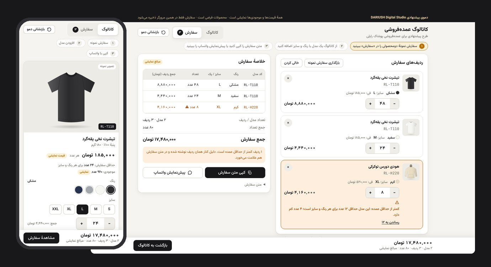

<div align="center">
  <h1>Wholesale Clothing Catalog Demo</h1>
  <p><b>A Persian, right-to-left, phone-first wholesale catalog with an editable order, minimum-order checks, a structured summary and a WhatsApp preview.</b></p>
  <p>Proposal demo by <b>DARIUSH Digital Studio</b> for <b>Raily</b> clothing wholesale · products are hypothetical, prices and stock are for display only</p>
  <p>
    <a href="https://dariush-tech.github.io/raily-wholesale-catalog-demo/"><b>Live demo</b></a> ·
    <a href="#demo-flow">Demo flow</a> ·
    <a href="#run-locally">Run locally</a>
  </p>
  <p>
    
    
    
    
    
  </p>
  
</div>

<div dir="rtl">

### خلاصه

دموی پیشنهادی DARIUSH Digital Studio برای عمده‌فروشی پوشاک رایلی. شش محصول فرضی با تصویر نمونه، کد مدل، رنگ‌ها، سایز یا پک و حداقل سفارش نمایش داده می‌شود. خریدار برای هر مدل رنگ، سایز یا پک و تعداد را انتخاب می‌کند، چند مدل را به سفارش اضافه می‌کند و تعداد هر ردیف را تغییر می‌دهد. اگر تعداد کمتر از حداقل عمده باشد، دلیلش کنار همان ردیف نوشته می‌شود. در پایان خلاصهٔ ساختاریافته، دکمهٔ «کپی متن سفارش» و «پیش‌نمایش واتساپ» (بدون باز کردن چت واقعی) هست. همهٔ قیمت‌ها و موجودی‌ها نمایشی است.

</div>

## Demo flow

1. **Open the sample order.** A two-product sample (two T-shirt rows and one hoodie row) is ready on first visit, including one row below the wholesale minimum so its warning is visible straight away.
2. **Add a model.** In the catalog, pick a colour (the garment image recolours), a size or pack and a quantity, then add it. Adding the same model, colour and size again merges into the existing row.
3. **Share the order.** Edit any row's quantity, then copy the order text or open the WhatsApp preview, which shows the same text in a chat-style frame without opening a real chat.

## Features

- **Six hypothetical products** (T-shirt, hoodie, jeans, shirt, kids set sold in size-run packs, socks in 6- and 12-pair packs), each with a model code, colours, size or pack, minimum order, and price and stock labelled as display-only.
- **Recolouring sample images.** Garments are drawn as inline SVG and take the selected colour, so every colour option has its own image.
- **Minimum-order checks** per row (per colour and size): the reason and the missing quantity appear next to the row, with a one-tap fix, and the row is flagged in the summary and the copied text.
- **Structured summary** with model code, colour, size or pack, quantity and row total, plus model, row, piece and pack counts and the order total.
- **Copy order text** through the Clipboard API, with a select-to-copy fallback.
- **Local persistence.** The order is saved in `localStorage`; the reset button restores the sample order.
- Light and dark themes, phone-first layout with a sticky order bar, and keyboard-accessible controls.

## Order text format

Each line starts with Persian text so messaging apps render it right-to-left:

```
سفارش عمده · پوشاک رایلی (نسخهٔ نمایشی)
تاریخ: ۳۰ آبان ۱۴۰۵
—————————————
۱) تیشرت نخی یقه‌گرد
   کد مدل: RL-T110 | رنگ: مشکی
   سایز: L | تعداد: ۴۸ عدد
   فی: ۱۸۵٬۰۰۰ | جمع ردیف: ۸٬۸۸۰٬۰۰۰ تومان
...
جمع سفارش: … تومان
* قیمت‌ها و موجودی نمایشی است.
```

## Project structure

```
raily-wholesale-catalog-demo/
├── index.html    # markup, styles, garment artwork and scripts (single file, no build step)
└── docs/         # README media
```

## Run locally

```bash
git clone https://github.com/dariush-tech/raily-wholesale-catalog-demo.git
cd raily-wholesale-catalog-demo
python3 -m http.server 8000
# open http://localhost:8000
```

---

Design & development: [Dariush Technology](https://github.com/dariush-tech) · DARIUSH Digital Studio
